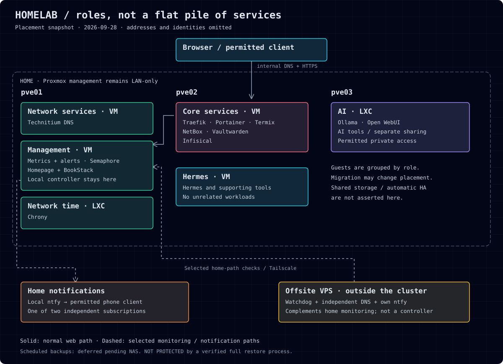

# Homelab

A three-node Proxmox homelab with separate roles for networking, core services,
management, Hermes tooling, and local AI. An offsite VPS watches for loss of
contact with home and has its own notification service.

The goal is a lab that is useful day to day: one place to find services, a wiki
that can be edited in a browser, and alerts that do not depend entirely on the
machine they are monitoring.

## What's here

| Directory | Contents |
| --- | --- |
| [Homepage](stacks/homepage/README.md) | Searchable, links-only service directory and pinned Compose example |
| [BookStack](stacks/bookstack/README.md) | Browser-editable manual, MariaDB, and private bootstrap instructions |
| [Monitoring](monitoring/README.md) | Reusable Prometheus alert rules and notification configuration |
| [Offsite watchdog](offsite/README.md) | Python outage observer, persistent delivery queue, and local tests |
| [Operations](docs/operations.md) | Access boundaries, maintenance approach, and recovery limitations |

These are selected, sanitized examples from a working lab—not a complete
one-command rebuild. Private addresses, personal domains, accounts, keys,
databases, and wiki content are deliberately left out. Example destinations use
`example.net` and documentation-only IP ranges; replace them before use.

## Layout and choices

The documented placement is a **2026-09-28 snapshot**, not a live status page.
Guest placement may change when VMs migrate.

| Host role | Type | Placement | Purpose |
| --- | --- | --- | --- |
| Network services | VM | pve01 | Technitium DNS |
| Management | VM | pve01 | Prometheus, Grafana, Alertmanager, ntfy, Semaphore, Homepage, BookStack |
| Network time | LXC | pve01 | Chrony |
| Core services | VM | pve02 | Traefik, Portainer, Termix, NetBox, Vaultwarden, Infisical |
| Hermes | VM | pve02 | Hermes and its supporting tooling only |
| AI | LXC | pve03 | Ollama, Open WebUI, and AI tools |
| Offsite observer | External VPS | Outside the cluster | Independent home-path checks and ntfy |

- **Proxmox** separates workloads without turning every application into a VM.
- **Portainer** owns Docker stack changes; a second Compose deployment must not
  compete with a managed stack.
- **Homepage** is a directory, not another privileged control panel: no Docker
  socket, administrator API credentials, or metrics integrations.
- **BookStack** holds the practical operating manual. **NetBox** holds structured
  inventory. This repository explains the design and selected configurations;
  it is not an automatic mirror of either service.
- **Tailscale** supplies permitted remote paths. Physical Proxmox nodes remain
  LAN-only, and shared AI services stay separate from management services.
- **Offsite monitoring** supplements home monitoring instead of moving the local
  controller outside the lab.

## Try one component

Start with the [Homepage local preview](stacks/homepage/README.md). It needs a
Linux Docker host and Docker Compose; it does not need a vault account or access
to this lab. BookStack also requires locally generated secrets. The watchdog uses
Python's standard library and can run its tests without Docker or real targets.

Each component documents its own setup and checks. There is intentionally no
root-level command that deploys or updates the entire network. Image pins record
the source deployment versions, not a promise that they are the newest release.

## Current limits

**Scheduled backups are deferred pending a NAS. The lab is NOT PROTECTED by a
verified full recovery process.** Persistent volumes, exported pages, and saved
Compose files are useful but are not substitutes for consistent application
backups and restore tests.

Restart persistence and selected application behavior were tested during the
original deployments. Full disaster recovery, whole-home outage/reconnection,
and host-reboot recovery have not been demonstrated by this publication copy.
See [operations](docs/operations.md) for the practical boundaries.

## Upstream projects

[Proxmox](https://www.proxmox.com/en/proxmox-virtual-environment/overview) ·
[Homepage](https://gethomepage.dev/) ·
[BookStack](https://www.bookstackapp.com/) ·
[Prometheus](https://prometheus.io/) ·
[Grafana](https://grafana.com/oss/grafana/) ·
[ntfy](https://docs.ntfy.sh/) ·
[Tailscale](https://tailscale.com/)

## License

The configuration examples, documentation, and code in this repository are
licensed under the [MIT License](LICENSE). Third-party applications retain their
own licenses.
