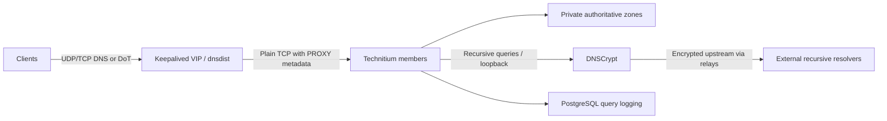

# DNS: shared ingress, distributed resolvers

## Documented design

The maintained November configuration records describe three DNS containers on
pve02, pve04 and pve05. Keepalived gives clients one virtual address; dnsdist
fronts a pool of Technitium members. Native catalog replication distributes the
private authoritative zones. Recursive queries use same-node DNSCrypt upstreams.

The plaintext dnsdist-to-Technitium leg matters: encryption on the client and
upstream edges does not make the whole path end-to-end encrypted. The documented
November transport disables the lab's own DoH endpoint while retaining DoT.
PROXY metadata preserves the client source visible at ingress, not an identity
already hidden by another NAT boundary.

Private authoritative health and external recursive health are different checks.
The query logger adds a database dependency and data-retention responsibility;
logging configuration alone does not establish bounded retention or log backups.

## What was checked

On 12 November, all three DNS guests were running in the hypervisor inventory.
Only dns1 received a fresh service-manager check: DNS, dnsdist, dnscrypt-proxy,
nginx and Keepalived reported started. This does not revalidate every configuration
line, VIP election, client resolver choice or all-node answers.

Earlier private records include selected all-node/VIP answers and a scoped restore
exercise. Those are dated observations, not a public reproducible receipt or proof
of current whole-system failover. Current client/VLAN coverage, query-history
retention, delivered alerts and complete recovery remain unresolved by this repo.

[Inventory](../inventory.md) · [Verification](../verification.md) ·
[PostgreSQL dependency](postgresql.md)
