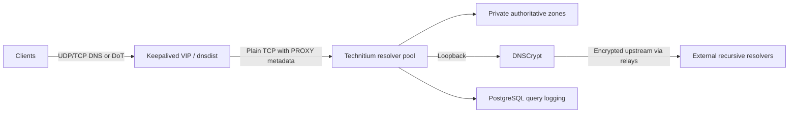

# DNS: fixing something that kept breaking

My DNS setup was fragile and broke frequently. I deployed a cluster because I
wanted it to be more resilient.

The cluster has three Technitium resolvers behind dnsdist. Keepalived manages the
virtual address clients use, so they do not need to know which member is
answering. Technitium's native catalog replication distributes private
authoritative zones. Recursive requests go through DNSCrypt on the same member.

## Keeping the client side simple

Clients keep the same resolver address when a member is down or being
maintained. Keepalived handles that address, dnsdist distributes queries,
and Technitium handles the DNS data. Those are separate jobs; moving the address
does not replicate a zone or fix a broken upstream.

The resolvers span three physical hosts. They share those hosts with PostgreSQL,
so the two clusters are not independent of each other's hardware failures.

## What the extra pieces do—and do not do

Clients can use DoT for encrypted DNS. The hop from dnsdist to Technitium is plain
TCP, though, so this is not an end-to-end encrypted path. PROXY metadata carries
the source address visible at ingress; it cannot recover an address already
hidden by NAT.

A private-zone lookup and an external recursive lookup exercise different parts
of the setup. One can work while the other is broken. Likewise, a running DNS
process alone does not establish that clients can get answers or that the
virtual address moves correctly during failover.

Query logs go to PostgreSQL. That adds a database dependency and retained query
data, but logging and answering queries are different concerns.

[PostgreSQL cluster](postgresql.md) · [Recovery](../operations.md)
