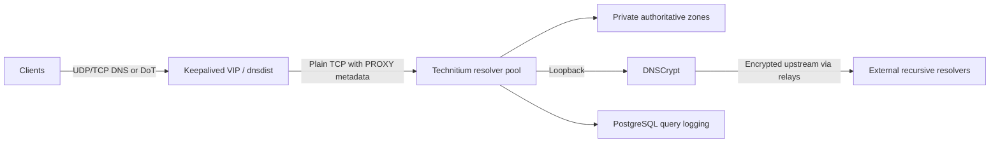

# DNS: one endpoint, three resolvers

The DNS design separates the address clients use from the resolvers answering
queries. Keepalived manages a virtual address, dnsdist fronts three Technitium
members, and native catalog replication distributes private authoritative zones.
Recursive requests use a same-member DNSCrypt upstream.

## Why separate ingress from resolution?

Clients keep a stable resolver address while dnsdist distributes requests across
members. Zone replication handles authoritative data separately from ingress
ownership. This avoids making a client configuration change part of routine
member maintenance.

The resolver members span three physical hosts. DNS and PostgreSQL share those
host failure domains: adding guests does not add independent hardware.

## Transport and observability

The client-facing encrypted transport is DoT. The dnsdist-to-Technitium hop is
plain TCP, so the complete path is not end-to-end encrypted. PROXY metadata
preserves the source visible at ingress; it cannot recover an address already
hidden by NAT.

Private-zone answers and external recursion need separate health checks. A
working internal record does not establish that recursive upstreams are usable.
PostgreSQL-backed query logging adds another dependency and a retention concern;
it should not be confused with the resolver's ability to answer queries.

A useful failover test has to check client answers and endpoint movement, not
just that the DNS processes are running.

[Database design](postgresql.md) · [Recovery](../operations.md)
