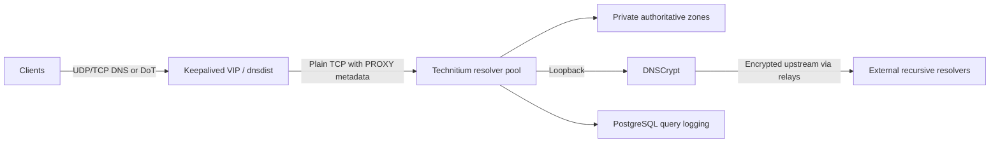

# DNS: fixing something that kept breaking

I let an agent deploy my first DNS service. It bound the service to Tailscale,
and every time the power went out—which happened a lot—I ended up repairing
DNS. That setup was more trouble than it was worth.

I removed the agent's "help" and deployed a cluster myself, without the Tailscale
bind. This project started with being tired of fixing my DNS.

## How a query moves through it

The cluster has three Technitium resolvers behind dnsdist. Keepalived manages the
virtual address clients use, so they do not need to know which member is
answering. Technitium's native catalog replication distributes private
authoritative zones. Recursive requests go through DNSCrypt on the same member.

## Blocking and answer filtering

Technitium's [Advanced Blocking](https://github.com/TechnitiumSoftware/DnsServer/tree/master/Apps/AdvancedBlockingApp)
app handles list-based blocking, explicit domain blocks, and pattern matching.
The same saved blocking configuration is deployed across all three members, so
filtering is not meant to depend on which one answers. Block lists are configured
to refresh daily.

AAAA filtering is also enabled. That is an answer-filtering policy for IPv6
address records, not a way to secure or disable IPv6 networking. It has exceptions,
so it is not a promise that every response will be IPv4-only.

DNSSEC validation checks signed DNS data where available. The checks included
valid signed answers and rejection of a deliberately broken signature. DNSSEC
is about authenticity of DNS data; it does not encrypt queries or make unsigned
names trustworthy.

## Keeping hard-coded DNS inside the policy

Some devices ignore the resolver supplied by the network. For the routed networks
covered by my DNS policy, UniFi redirects TCP and UDP port 53 requests aimed at
other resolvers back to the local cluster. This is DNAT at the router, not
conditional forwarding in Technitium. It brings ordinary hard-coded DNS through
the same blocking and logging path.

Firewall rules also restrict direct external DNS on ports 53 and 853, while
retaining the intended internal DoT path. Encrypted DNS over HTTPS needs separate
controls: UniFi application rules, known-provider address groups, and blocks for
resolver endpoint domains cover known alternatives without blocking ordinary
HTTPS.

Those provider lists need maintenance. This is enforcement of a local resolver
policy, not detection of every malicious DNS server or a guarantee against
bypass. Arbitrary HTTPS tunnels are not comprehensively controlled, and traffic
between devices on the same local network may never pass through the router.

## Encrypted and diverse upstreams

I gave each DNS server a different set of upstream resolvers and relays. The
[public DNSCrypt directory](https://github.com/DNSCrypt/dnscrypt-resolvers/blob/master/v3/public-resolvers.md)
includes independent, nonprofit, and company-operated services.
I didn't want every member depending on the same upstreams. If a
resolver or relay goes down, that reduces the chance of it taking out recursive
DNS across the whole cluster. Different endpoints can still share infrastructure,
so this is upstream diversity, not a guarantee against outages. DNSCrypt's
[example configuration](https://github.com/DNSCrypt/dnscrypt-proxy/blob/master/dnscrypt-proxy/example-dnscrypt-proxy.toml)
documents choosing resolver/relay pairs across operators and ISPs.

DNSCrypt encrypts upstream queries. With
[Anonymized DNSCrypt](https://github.com/DNSCrypt/dnscrypt-protocol/blob/master/ANONYMIZED-DNSCRYPT.txt),
the relay sees the client's public address but not the query contents; the
resolver sees the queries and the relay's address. When independently operated,
the relay and resolver each have only part of that information.

## Keeping the client side simple

Clients keep the same resolver address when a member is down or being
maintained. Keepalived handles that address, dnsdist distributes queries,
and Technitium handles the DNS data. Those are separate jobs; moving the address
does not replicate a zone or fix a broken upstream.

The resolvers span three physical hosts. They share those hosts with PostgreSQL,
so the two clusters are not independent of each other's hardware failures.

## Client attribution and query history

Clients can use DoT for encrypted DNS. The hop from dnsdist to Technitium is plain
TCP, though, so this is not an end-to-end encrypted path. PROXY metadata carries
the source address visible at ingress; it cannot recover an address already
hidden by NAT.

The three members send query logs to PostgreSQL over TLS with certificate and
hostname verification. That gives me a shared history for troubleshooting;
PostgreSQL is not Technitium's zone store. Logging is asynchronous and can drop
events if its queue fills, so I do not treat it as a lossless audit trail.

## Checking the parts separately

A private-zone lookup and an external recursive lookup exercise different parts
of the setup. One can work while the other is broken. Likewise, a running DNS
process alone does not establish that clients can get answers or that the
virtual address moves correctly during failover.

The blocking, validation, and routed enforcement described here were checked on
November 5, 2026. Those checks are evidence for the individual controls, not a
claim that every client or bypass path has been tested.

[PostgreSQL cluster](postgresql.md) · [Recovery](../operations.md)
