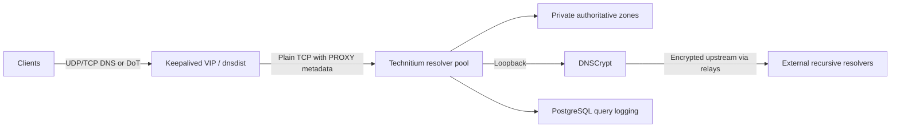

# DNS: fixing something that kept breaking

I let an agent deploy my first DNS service. It bound the service to Tailscale,
and every time the power went out—which happened a lot—I ended up repairing
DNS. That setup was more trouble than it was worth.

I removed the agent's "help" and deployed a cluster myself, without the Tailscale
bind. This project started with being tired of fixing my DNS.

The cluster has three Technitium resolvers behind dnsdist. Keepalived manages the
virtual address clients use, so they do not need to know which member is
answering. Technitium's native catalog replication distributes private
authoritative zones. Recursive requests go through DNSCrypt on the same member.

I gave each DNS server a different set of upstream resolvers and relays. The
[public DNSCrypt directory](https://github.com/DNSCrypt/dnscrypt-resolvers/blob/master/v3/public-resolvers.md)
includes independent, nonprofit, and company-operated services.
I didn't want every member depending on the same upstreams. If a
resolver or relay goes down, that reduces the chance of it taking out recursive
DNS across the whole cluster. Different endpoints can still share infrastructure,
so this is upstream diversity, not a guarantee against outages. DNSCrypt's
[example configuration](https://github.com/DNSCrypt/dnscrypt-proxy/blob/master/dnscrypt-proxy/example-dnscrypt-proxy.toml)
documents choosing resolver/relay pairs across operators and ISPs.

The separate paths are also about privacy and spreading trust: I don't want
every member trusting the same upstreams. DNSCrypt encrypts and authenticates
the upstream traffic. With
[Anonymized DNSCrypt](https://github.com/DNSCrypt/dnscrypt-protocol/blob/master/ANONYMIZED-DNSCRYPT.txt),
the relay sees my public address but cannot read the queries; the resolver sees
the queries and the relay's address rather than mine. That separation depends on
the relay and resolver being run by different operators. That's the design
intent, not an audit of the selected operators' independence. Three paths don't
make the encryption stronger or guarantee truthful answers from a resolver.

## Keeping the client side simple

Clients keep the same resolver address when a member is down or being
maintained. Keepalived handles that address, dnsdist distributes queries,
and Technitium handles the DNS data. Those are separate jobs; moving the address
does not replicate a zone or fix a broken upstream.

The resolvers span three physical hosts. They share those hosts with PostgreSQL,
so the two clusters are not independent of each other's hardware failures.

## What the extra pieces do—and do not do

Clients can use DoT for encrypted DNS. The hop from dnsdist to Technitium is plain
TCP, though, so this is not an end-to-end encrypted path. PROXY metadata carries
the source address visible at ingress; it cannot recover an address already
hidden by NAT.

A private-zone lookup and an external recursive lookup exercise different parts
of the setup. One can work while the other is broken. Likewise, a running DNS
process alone does not establish that clients can get answers or that the
virtual address moves correctly during failover.

Query logs go to PostgreSQL. That adds a database dependency and retained query
data, but logging and answering queries are different concerns.

[PostgreSQL cluster](postgresql.md) · [Recovery](../operations.md)
