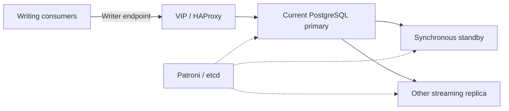

# PostgreSQL: one writer, separate routing

## Documented design

Three database containers live on pve02, pve04 and pve05. Maintained November
records describe PostgreSQL managed by Patroni with an etcd coordination layer.
HAProxy routes the client writer endpoint to the current primary; Keepalived
owns the client virtual address. These routes run with the database guests,
not through the web reverse proxy.

This is single-writer HA, not multi-primary SQL. The documented policy uses one
synchronous standby; it does not make all replicas equally current. The separate
replica endpoint may lag and is not causal read-after-write routing. HAProxy
routing is not SQL connection pooling or a security-enforced read-only boundary.

## Consumers and failure domains

DNS query logging, CA authoritative state and the CA dashboard's own state use
separate database roles. The dashboard's CA-state reader is distinct from its
application-state writer. Least-privilege roles and verified TLS are documented
configuration boundaries, not implied by the existence of the guests.

DNS and database members are distributed across the same three physical hosts.
Six guests therefore do not represent six independent host failure domains.
Replicas do not protect against propagated deletion, bad application writes or
loss of the whole site. Local consumer dumps do not establish recovery of etcd,
the complete cluster, every consumer or offsite copies.

## What was checked

On 12 November all three PostgreSQL guests were running. Only pg1 received a fresh
in-guest check: Patroni, HAProxy and Keepalived reported active. The fresh check did
not inspect replication roles, replay lag, etcd quorum, SQL writes, TLS or VIP ownership.

Maintained 11 November records report one primary and two streaming replicas,
selected consumer TLS connections and scoped CA/dashboard dump-and-restore work.
Those results are reported private evidence, not a fresh forced failover or a
public full-cluster restore demonstration. No measured RPO/RTO is claimed.

[CA dependency cycle](access-and-identity.md) · [Verification](../verification.md)
