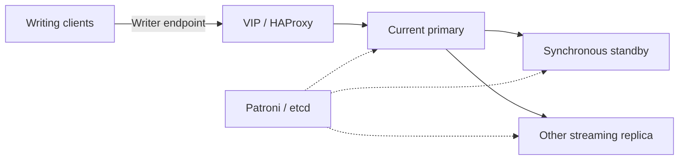

# PostgreSQL: one writer, separate routing

The database design uses three PostgreSQL members managed by Patroni, with etcd
for coordination. HAProxy directs the writer endpoint to the current primary;
Keepalived manages the client virtual address. Database traffic does not pass
through the web reverse proxy.

## Leadership is not routing

Patroni decides which member can lead. HAProxy gives clients a stable route to
that member. The two mechanisms solve different problems: moving an address
without checking leadership could send writes to the wrong server.

The policy uses one synchronous standby, not three writable databases. The
replica endpoint can lag, so it is unsuitable for reads that must immediately
observe a previous write. HAProxy is neither a connection pool nor a
security-enforced read-only boundary.

## Shared database service, separate permissions

DNS query logging and the certificate authority use separate database roles.
The CA administration application's own data is separate from its read access
to CA state. This keeps a UI's ordinary database credentials distinct from the
CA's authoritative writer.

The database and DNS members share three host failure domains. Replication helps
with member loss but also propagates bad writes and deletions. It does not
replace backups, and consumer SQL dumps alone do not recover etcd or the complete
database cluster. This write-up does not claim measured failover times or a
full-cluster restore result.

[Certificate dependencies](access-and-identity.md) · [Recovery](../operations.md)
