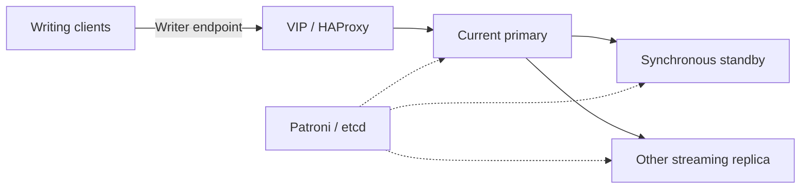

# PostgreSQL: curiosity, complexity and Patroni

I started building a PostgreSQL cluster because I was bored and curious. I began
watching a YouTube series on PostgreSQL clusters without realizing how involved
it would get. Eventually, I caved and used Patroni.

I wanted to try it, and there turned out to be a lot more to it than running
three copies of PostgreSQL.

The cluster has three PostgreSQL members managed by Patroni, with etcd for
coordination. HAProxy routes the writer endpoint to the current primary, and
Keepalived manages the virtual address clients use. Database traffic does not go
through the web reverse proxy.

## Choosing a primary is not the same as reaching it

Patroni manages which member can lead. HAProxy routes clients to that member.
Keepalived manages the address in front of HAProxy. Moving an address by itself
would not tell a client which PostgreSQL member should accept writes.

I use one synchronous standby, not three writable databases. The replica endpoint
can lag, so it is not suitable for a read that must immediately see a previous
write. HAProxy does not pool connections or enforce read-only access either.

## What uses it, and what replication leaves unsolved

DNS query logging and the certificate authority use separate database roles.
The CA administration application's own data is separate from its read access
to CA state, keeping its ordinary credentials distinct from the CA's writer.

The PostgreSQL members share three physical hosts with DNS. Losing a host can
affect both services, despite each having its own cluster.

Replication also copies bad writes and deletions. It is not a backup. Consumer
SQL dumps alone do not recover etcd or the complete cluster; those pieces matter
when recovering the database service, not just an individual application's data.

[Certificate dependencies](access-and-identity.md) · [Recovery](../operations.md)
